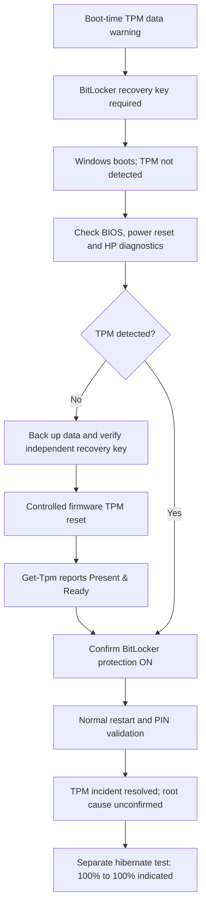

# Windows Endpoint Troubleshooting — TPM Recovery, Battery & Docked Displays

> **Status:** TPM/BitLocker incident resolved; first hibernation test passed; docked display/touchscreen symptoms initially resolved  
> **Platform:** HP ENVY x360 15-ey0xxx · AMD Ryzen 7 5825U · Windows 11 · Insyde BIOS F.22  
> **Cases documented:** October 11–12, 2026 · **Environment:** Personal, authorized laptop

## Executive summary

A personal Windows 11 laptop displayed a **Trusted Platform Module (TPM) data warning** during boot. BitLocker required its 48-digit recovery key, Windows Hello initially required PIN re-enrollment, and subsequent `Get-Tpm` queries reported `TpmPresent: False`. The issue persisted across multiple restarts and a full power reset, despite passing HP's hardware tests and a current BIOS check.

After **verifying an offline file backup and independently accessible BitLocker recovery key**, the TPM was reset using the firmware recovery prompt. Windows subsequently detected and provisioned the TPM, BitLocker protection was confirmed active, and a normal restart succeeded without recovery prompts.

A concurrent battery/standby investigation revealed the laptop's Modern Standby behavior and an unexplained power/battery reporting anomaly. The lid-close-on-battery action was changed from Sleep to Hibernate; the first overnight test reported **100% before lid closure and 100% the following morning**. This is a successful indicated-charge retention test, not proof that the original power anomaly cannot recur.

**Important limitation:** The controlled reset restored service, but the underlying reason the TPM data became unusable is **not proven**. There is **no evidence in this case of a cyberattack**.

A second, separate workstation troubleshooting case documented three external monitors, unreliable display behavior with the convertible lid open/closed, cursor-like circles on the primary external screen, and flickering. After configuring an extended desktop and disabling the built-in HID touchscreen, **both circles and flickering were no longer observed**. The input-device finding is strongly supported; the exact physical mechanism and long-term stability remain unverified. See the [docking and touchscreen case study](docs/docking-touchscreen-case-study.md).

## Why this is in a cybersecurity portfolio

- **Security architecture:** TPM, measured boot, BitLocker key protectors, Windows Hello, and Secure Boot are related but distinct.
- **Incident troubleshooting:** Preserve access and evidence, isolate symptoms, test hypotheses, remediate, then validate.
- **Risk management:** Back up data and verify independent recovery credentials before changing trust anchors.
- **Windows diagnostics:** `Get-Tpm`, `manage-bde`, Event Viewer, HP PC Hardware Diagnostics, `powercfg`.
- **Endpoint integration:** Isolate input-device artifacts from display configuration and video-connection problems.
- **Reporting:** Separate observed facts, plausible explanations, and unresolved questions.

## High-level incident workflow



## Confirmed outcomes

| Check | Before remediation | After remediation |
|:--|:--|:--|
| TPM recognized by Windows | `TpmPresent: False` | `True` |
| TPM initialized | `TpmReady: False` | `True` |
| BitLocker startup | Recovery key required | Normal restart; no recovery key prompt |
| Windows Hello | PIN needed re-enrollment during incident | Existing PIN worked after resolution |
| Drive encryption | Protected but recovery required at boot | 100% encrypted; BitLocker protection ON |
| HP hardware diagnostics | All tests passed | No new fault reported |
| Battery/lid close | Sleep / Modern Standby | Hibernate on battery; 100% to 100% reported overnight |

## Two complementary case studies

| Case | Problem | Evidence-based action | Outcome |
|:--|:--|:--|:--|
| [1 — TPM/BitLocker security recovery](docs/incident-timeline.md) | TPM data warning, recovery-key prompts, TPM not detected | Safe backup/recovery preparation; firmware TPM reset; TPM and BitLocker validation | Resolved at final restart; trigger unproven |
| [2 — Docked display and touchscreen input](docs/docking-touchscreen-case-study.md) | Three external monitors; circles on display 2; flickering when lid closed/moved | Extended display layout, internal display disconnected, reversible HID touchscreen isolation | Both reported symptoms absent after disabling touch; long-term validation pending |

The second case is an endpoint-support/integration problem, **not** a confirmed cyber incident.

## Repository guide

| File | Purpose |
|:--|:--|
| [`docs/incident-timeline.md`](docs/incident-timeline.md) | Chronological evidence and actions |
| [`docs/diagnostic-findings.md`](docs/diagnostic-findings.md) | TPM, BitLocker, BIOS, HP diagnostics and event analysis |
| [`docs/remediation-and-validation.md`](docs/remediation-and-validation.md) | Safeguards, corrective action, results |
| [`docs/battery-and-power-analysis.md`](docs/battery-and-power-analysis.md) | Battery report and SleepStudy analysis |
| [`docs/docking-touchscreen-case-study.md`](docs/docking-touchscreen-case-study.md) | Independent-display, phantom-touch and flicker isolation |
| [`data/docking-validation.csv`](data/docking-validation.csv) | Sanitized before/after validation log |
| [`docs/lessons-learned.md`](docs/lessons-learned.md) | Takeaways and next investigations |
| [`scripts/Collect-SafeDiagnostics.ps1`](scripts/Collect-SafeDiagnostics.ps1) | **Read-only** Windows diagnostic snapshot generator |
| [`data/overnight-hibernate-test.csv`](data/overnight-hibernate-test.csv) | Recorded initial October 11–12 overnight test |
| [`PUBLICATION-CHECKLIST.md`](PUBLICATION-CHECKLIST.md) | Prevent accidental data disclosure |
| [`UPDATE-EXISTING-REPO.md`](UPDATE-EXISTING-REPO.md) | Instructions to update an already published GitHub repo |

## Safe diagnostic commands

Run these locally from an elevated PowerShell session when investigating **your own or an authorized device**:

```powershell
Get-Tpm
manage-bde -status C:
powercfg /a
powercfg /batteryreport /output "$env:USERPROFILE\battery-report.html"
powercfg /sleepstudy /duration 7 /output "$env:USERPROFILE\sleepstudy.html"
```

These commands observe or generate reports; they do not clear the TPM or decrypt the drive. **The HTML reports may contain computer names, device information, and application paths and should not be committed to a public repository.**

The optional script collects a **minimal, privacy-conscious summary** into an ignored `local-diagnostics/` directory:

```powershell
powershell.exe -NoProfile -File .\scripts\Collect-SafeDiagnostics.ps1
```

> Do **not** use this repository as an instruction to blindly reset a TPM. The firmware action taken in this case can invalidate device-bound secrets and require recovery. Read the safeguards in [`docs/remediation-and-validation.md`](docs/remediation-and-validation.md).

## October 11–12 overnight hibernation test

- Lid-close-on-battery setting: **Hibernate** (previously Sleep).
- Indicated charge before closing the laptop: **100%**.
- Indicated charge on the morning of October 12: **100%**.
- **Result:** 0 percentage-point change shown by Windows; initial overnight battery-retention test passed.
- Exact times and whether system logs independently confirm entry into hibernation: **not recorded**.
- No separate assertion is made about morning TPM/BitLocker warnings; those were not specifically reported with this battery reading.

A whole-number battery indicator may conceal a small change. One successful night is encouraging but does not fully explain the previous abrupt battery reading or prove its root cause. See [`data/overnight-hibernate-test.csv`](data/overnight-hibernate-test.csv).

## October 12 docked-display follow-up

The workstation used three external displays plus the laptop's internal panel (Windows displays **2–4 external**, **1 internal**). After the internal display was disconnected from the desktop layout, the closed-lid setup still showed touch-style circles on the **primary external display 2**, along with flickering. Turning off **HID-compliant touch screen** in Windows Device Manager removed the circles, and the user reported no further flickering at immediate follow-up. 

Operating configuration: **plugged in → Do nothing on lid close; on battery → Hibernate on lid close**. The touchscreen remains disabled unless re-enabled manually. Because this was not a controlled hardware experiment, the exact mechanism is **not proven**, and the USB-C connection hypothesis was not fully excluded. Keep the laptop's cooling vents unobstructed while operating with lid closed. See [case study 2](docs/docking-touchscreen-case-study.md) and [validation log](data/docking-validation.csv).

## References

- [Microsoft Learn — Get-Tpm](https://learn.microsoft.com/en-us/powershell/module/trustedplatformmodule/get-tpm)
- [Microsoft Learn — BitLocker operations guide](https://learn.microsoft.com/en-us/windows/security/operating-system-security/data-protection/bitlocker/operations-guide)
- [Microsoft Learn — manage-bde status](https://learn.microsoft.com/en-us/windows-server/administration/windows-commands/manage-bde-status)
- [Microsoft Learn — Modern Standby SleepStudy](https://learn.microsoft.com/en-us/windows-hardware/design/device-experiences/modern-standby-sleepstudy)
- [Microsoft Learn — Powercfg command-line options](https://learn.microsoft.com/en-us/windows-hardware/design/device-experiences/powercfg-command-line-options)

## Scope and privacy

Only **sanitized, manually reviewed** facts from a personal laptop are published. Raw system reports, BitLocker recovery keys, device serial numbers, screenshots, personal identifiers and employer-managed information are **not included**. See [`PUBLICATION-CHECKLIST.md`](PUBLICATION-CHECKLIST.md).

## License

MIT License; see [`LICENSE`](LICENSE). This is a documented troubleshooting case, not an official HP or Microsoft repair procedure.
