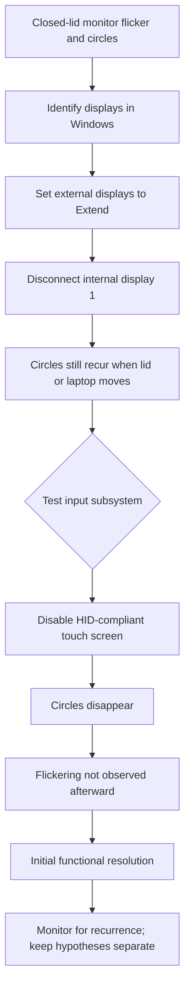

# Case study 2 — External-display instability traced to touchscreen input

> **Status:** Initial symptoms resolved; monitor for recurrence.  
> **Environment:** Personal Windows 11 HP ENVY x360, used with a Lenovo ThinkPad Hybrid USB-C with USB-A Dock and three external displays.  
> **Date documented:** October 12, 2026.  
> **Privacy:** The original screenshots, monitor identifiers, device serials and detailed system reports are not included.

## Executive summary

A docked laptop displayed different desktops unreliably when the convertible touchscreen's lid position changed. With the lid open, the user initially saw mirrored content instead of the desired independent external desktops. With the lid closed, **circular touch indicators appeared on the main external screen**, accompanied by flickering. Movement of the closed laptop appeared to provoke a recurrence.

Windows **detected four displays** (one internal and three external). The internal laptop panel was identified as **display 1**; the chosen primary external monitor was **display 2**. Extending the external displays and disconnecting the internal display addressed the desired layout but did not, by itself, eliminate the circles. Disabling the **HID-compliant touch screen** device in Windows Device Manager caused the circles to disappear; the user subsequently reported that the flickering also appeared resolved.

**Assessment:** Unintended touch input, potentially influenced by lid position or touch/display mapping, was strongly implicated. The exact physical mechanism and whether any separate dock-cable contribution existed were **not demonstrated**. No evidence from this case establishes a failed GPU, a defective dock, or a cybersecurity intrusion.

## User requirements and constraints

- Use **three independent external monitors**, not mirrored desktops.
- Operate the laptop with the **lid fully closed** while docked.
- Maintain the previously successful **Hibernate when lid closes on battery** behavior.
- Keep the laptop running while **plugged in and lid closed**.
- Prefer reversible settings changes over hardware replacement.

## Observations and actions

| Stage | Observation or action | Outcome / interpretation |
|:--|:--|:--|
| 1. Symptom | Lid open: screens showed matching content; partially closed configuration seemed to work better | Initially suggested display-mode or display-configuration issue |
| 2. Symptoms with lid closed | Touch-like circles on primary external monitor (#2) and screen flickering | Circles suggested Windows was responding to touch input; flicker had multiple possible causes |
| 3. Physical movement | Sliding the closed laptop was followed by flickering and circles | Raised both lid/touchscreen interaction and USB-C cable-strain hypotheses; not a controlled isolation test |
| 4. Display discovery | Windows Display settings showed four separately identified displays; laptop was #1 | Established Windows display enumeration; **not** a verified wiring diagram |
| 5. Display configuration | Internal laptop display #1 disconnected; external displays kept as an extended desktop | Supported external-only working layout |
| 6. Power behavior | On battery: lid close → Hibernate. Plugged in: lid close → Do nothing | Allowed docked operation with closed lid without undoing the earlier overnight battery solution |
| 7. Isolation test | Disabled **HID-compliant touch screen** under Device Manager → Human Interface Devices | Circles immediately stopped |
| 8. Follow-up | User observed that **both circles and flickering appeared resolved** | Strong evidence of touchscreen involvement, pending longer-term confirmation |

### Troubleshooting sequence

## Initial validation record

| Acceptance check | Result |
|:--|:--|
| Three external screens recognized | **Observed** in four-display Windows layout (three external + internal) |
| External screens work as independent desktops | **User reported operational setup** after display reconfiguration |
| Internal laptop display excluded from docked layout | **Confirmed action**: display #1 disconnected |
| Laptop operates with lid fully closed on AC power | **User-reported operational state** |
| Circles after disabling touchscreen | **Not observed** |
| Flickering after disabling touchscreen | **Not observed at follow-up** |
| Repeated long-duration or movement-stress validation | **Not yet documented** |

## Controls, limitations and operational notes

**Reversible test.** Device Manager → Human Interface Devices → HID-compliant touch screen → Disable device. To restore tablet/touch functionality, choose **Enable device** on the same item. Disabling a display in Windows Display settings is separate from disabling its touch input.

**Dock topology not verified.** The number of connectors on the Lenovo dock does not establish how the three external monitors were connected. Their video cabling, any direct laptop connection, adapter paths, display drivers and cable quality were **not captured**. Do not claim a measured dock bandwidth or that all three displays were supported directly by a single dock.

**No confirmed physical defect.** There was no controlled test comparing USB-C cable movement with stationary lid/touch panel, no device-driver isolation, and no hardware replacement. Both problems appearing to resolve with the touchscreen disabled makes unintended input the best-supported hypothesis, but not a laboratory proof of mechanism.

**Closed-lid thermal safety.** Provide clear ventilation around laptop intake/exhaust openings. If the laptop becomes unusually hot, throttles or shuts down, stop the closed-lid test and inspect the manufacturer's cooling requirements.

**Power policy.** The settings here were **plugged in: Do nothing on lid close; on battery: Hibernate on lid close**. These are intentional, distinct operating modes; the user should not assume closing an unplugged laptop leaves it active.

## If symptoms recur

1. Note which monitor has the circles and whether the mouse pointer jumps or clicks unexpectedly.
2. Check whether touch input remains disabled. If it was re-enabled, repeat the controlled isolation test.
3. Verify Windows Display settings and the external monitors' extend/duplicate configuration.
4. With the laptop stationary, check the dock cable seating and video cables without sharply flexing connectors.
5. Inspect DisplayLink/graphics/dock driver versions and update using trusted vendor sources **only if necessary**.
6. Record whether flicker occurs independent of touch circles; if so, open a separate video-path investigation.

## Transferable technical skills

- **Hypothesis-driven troubleshooting:** Distinguished display configuration, input subsystem and physical-connection theories.
- **Controlled change:** Disabled one reversible HID device instead of replacing the dock or making untested firmware changes.
- **Layer awareness:** Windows display topology and touchscreen input routing are related but different subsystems.
- **Validation:** Recorded before/after behavior and distinguished immediate results from long-term stability.
- **Security hygiene:** Excluded raw workstation captures and employer-specific configuration details.

This is an **endpoint support and systems-integration troubleshooting case study**, not a security incident. It complements the TPM/BitLocker recovery incident in this repository.
